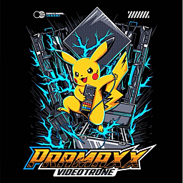

<div align="center">



# PLM-Motion Studio

**Web editor visual untuk membuat dan mengelola animasi `plm-motion`**
_Preset animasi logo motion untuk sistem LED Videotron Pramaxx_

---

[](https://react.dev)
[](https://www.typescriptlang.org)
[](https://vite.dev)
[](https://www.remotion.dev)
[](https://tailwindcss.com)

</div>

---

## 📖 Tentang Aplikasi

**PLM-Motion Studio** adalah web editor visual untuk membuat, mengedit, dan mengelola preset animasi dalam format **`plm-motion`** — format animasi proprietary Pramaxx yang dikonsumsi oleh aplikasi Godot untuk menghidupkan logo di layar LED Videotron.

Dengan editor ini, kamu bisa:

- Menganimasikan **posisi**, **rotasi**, dan **skala** sebuah objek secara visual
- Melihat hasilnya secara **real-time** lewat preview berbasis Remotion
- Menyetel **easing curve** (Bezier) per keyframe untuk animasi yang halus
- **Menyimpan preset** ke server API atau **mengekspor** sebagai file `.json`

---

## ✨ Fitur Utama

| Fitur                       | Deskripsi                                                               |
| --------------------------- | ----------------------------------------------------------------------- |
| 🎬 **Preview Real-time**    | Lihat animasi langsung saat mengedit, powered by Remotion Player        |
| 🎯 **Timeline Visual**      | Tambah, geser, dan hapus keyframe dengan drag-and-drop                  |
| 🔧 **Keyframe Inspector**   | Edit nilai X/Y/rotation/scale secara presisi lewat slider & input       |
| 📐 **Bezier Easing Editor** | Desain kurva easing dengan 2 handle yang bisa di-drag secara interaktif |
| ☁️ **Simpan ke API**        | Push langsung ke backend Laravel untuk disimpan di database             |
| 📦 **Import / Export JSON** | Impor dari clipboard JSON atau ekspor ke file `.plm-motion.json`        |
| 🔑 **Auth via Device ID**   | Login menggunakan Machine ID yang sudah terdaftar di sistem             |
| 📋 **Dashboard Motion**     | Kelola semua preset: lihat, edit, dan hapus dari satu halaman           |
| ⌨️ **Keyboard Shortcuts**   | Navigasi cepat dengan shortcut keyboard standar editor animasi          |

---

## 🏗️ Tech Stack

```
Frontend  : React 19 + TypeScript 7
Build     : Vite 8
Styling   : Tailwind CSS 4
Preview   : Remotion 4 (@remotion/player)
State     : Zustand 5
Backend   : Laravel REST API (terpisah)
```

---

## 🚀 Memulai (Development)

### Prasyarat

- **Node.js** versi 18 atau lebih baru
- **npm** atau package manager lain (pnpm/yarn)
- Backend Laravel API yang sudah berjalan (lihat [Konfigurasi API](#-konfigurasi-api))

### Instalasi

```bash
# 1. Clone repository
git clone https://github.com/pramaxx-software/motion-studio.git
cd motion-studio

# 2. Install dependencies
npm install

# 3. Buat file environment
cp .env.example .env
# (atau buat manual, lihat bagian Konfigurasi API di bawah)

# 4. Jalankan dev server
npm run dev
```

Aplikasi akan berjalan di `http://localhost:5173`.

### Build Production

```bash
npm run build
```

Output build ada di folder `dist/`, siap di-deploy ke web server (Apache/Nginx).

---

## ⚙️ Konfigurasi API

Buat file `.env` di root project dan isi dengan URL backend API kamu:

```env
VITE_API_BASE_URL=http://localhost:8000/api
```

> Jika `VITE_API_BASE_URL` tidak di-set, default-nya akan menggunakan `http://localhost:8000/api`.

Semua request API menggunakan **Bearer Token** (JWT) yang didapat setelah login.

---

## 📚 Panduan Penggunaan

### Alur Kerja Umum

```
Login (Device ID)
       ↓
  Dashboard  ──→  Buat Motion Baru  ──→  Editor
       ↓                                    ↓
 Edit Motion yang ada                  Atur Properties
                                            ↓
                                    Tambah Keyframe di Timeline
                                            ↓
                                    Setel Nilai & Easing
                                            ↓
                               Simpan ke API / Export JSON
```

---

### 1. 🔑 Login

Halaman pertama yang muncul saat membuka aplikasi adalah halaman **Login**.

> Autentikasi menggunakan **Device ID** (Machine ID) — bukan username/password.
> Device ID harus sudah terdaftar di sistem backend Pramaxx.

**Cara Login:**

1. Buka aplikasi di browser
2. Masukkan **Device ID** kamu di field `Device ID`
   - Format contoh: `ABCD-1234-EFGH`
3. Klik tombol **Masuk Studio**
4. Jika berhasil, kamu akan diarahkan ke **Dashboard**

> **Catatan:** Token sesi disimpan di `localStorage` browser, sehingga kamu tidak perlu login ulang setiap kali membuka aplikasi — kecuali sesi berakhir atau kamu klik "Keluar".

---

### 2. 📋 Motion Dashboard

Setelah login, kamu akan melihat **Motion Dashboard** — pusat kendali untuk semua preset animasi yang tersimpan.

**Elemen Dashboard:**

| Elemen                           | Fungsi                                              |
| -------------------------------- | --------------------------------------------------- |
| **Header**                       | Menampilkan nama user yang login dan tombol Keluar  |
| **Tombol "+ Bikin Motion Baru"** | Membuka editor dengan template motion kosong        |
| **Search Bar**                   | Filter preset berdasarkan nama secara real-time     |
| **Card Grid**                    | Daftar semua preset motion yang tersimpan di server |

**Cara Membuat Motion Baru:**

Klik tombol **`+ Bikin Motion Baru`** di kanan atas → editor akan terbuka dengan preset default (rotasi 360° selama 2 detik).

**Cara Mengedit Motion yang Ada:**

Temukan card motion yang ingin diedit → klik tombol **`Edit Visual`** → editor terbuka dengan data motion tersebut ter-load.

**Cara Menghapus Motion:**

Di card motion yang bersangkutan → klik tombol **`Hapus`** → konfirmasi di dialog → motion dihapus dari server.

---

### 3. 🎛️ Layout Editor

Editor adalah tampilan utama tempat kamu mendesain animasi. Terdiri dari 4 area:

```
┌─────────────────────────────────────────────────────────┐
│                        TOOLBAR                          │
├──────────────────────────────┬──────────────────────────┤
│                              │                          │
│        PREVIEW PANEL         │    PROPERTIES PANEL      │
│    (Remotion Player)         │   (3 Tab: Properties /   │
│                              │   Inspector / JSON)      │
│                              │                          │
├──────────────────────────────┴──────────────────────────┤
│                       TIMELINE                          │
│         (Track POS / ROT / SCL + Scrubber)              │
└─────────────────────────────────────────────────────────┘
```

---

### 4. 🔧 Toolbar

Bar di bagian paling atas editor. Berisi kontrol global untuk motion yang sedang dikerjakan.

**Elemen Toolbar:**

| Elemen                  | Fungsi                                                        |
| ----------------------- | ------------------------------------------------------------- |
| **← Dashboard**         | Kembali ke halaman Motion Dashboard                           |
| **Indikator Status**    | Lingkaran hijau ✅ = payload valid; merah ❌ = tidak valid    |
| **Input Nama Motion**   | Nama motion (maks. 64 karakter). Langsung bisa diedit di sini |
| **Tombol "Simpan API"** | Simpan motion baru ke server (POST)                           |
| **Tombol "Update API"** | Update motion yang sedang diedit (PUT)                        |
| **Shortcuts (?)**       | Buka daftar keyboard shortcut                                 |
| **Import JSON**         | Impor payload dari teks JSON                                  |
| **Export**              | Download motion sebagai file `.plm-motion.json`               |

> **Indikator Status** berubah merah jika `duration ≤ 0` atau semua track kosong. Pastikan indikator **hijau** sebelum menyimpan.

---

### 5. 📐 Properties Panel

Panel di sebelah kanan editor dengan 3 tab:

#### Tab `Properties` — Pengaturan Dasar Motion

Atur parameter utama motion di sini:

**Nama Motion**

- Nama display untuk preset ini (maks. 64 karakter)
- Sama dengan yang terlihat di toolbar

**Durasi (Detik per Loop)**

- Berapa lama satu siklus animasi (dalam detik)
- Nilai minimal: `0.1` detik
- Contoh: `2.0` = animasi loop setiap 2 detik

**Mode Axis**

| Mode            | Deskripsi                                                                              |
| --------------- | -------------------------------------------------------------------------------------- |
| `2D (Standard)` | Animasi datar, hanya posisi, rotasi Z, dan skala                                       |
| `3D (+ Y-Spin)` | Tambahan rotasi Y-axis (flip horizontal) menggunakan CSS `rotateY`, memberikan efek 3D |

**Pixel Scale** _(Opsional)_

- Faktor konversi pixel ke world unit: `0.0005` sampai `0.1`
- Biarkan kosong jika tidak diperlukan

**Versi Format**

- Integer ≥ 1, digunakan sebagai penanda versi payload
- Default: `1`

---

#### Tab `Inspector` — Keyframe Inspector

Tab ini menampilkan detail dari **keyframe yang sedang dipilih** di timeline.

> Klik keyframe (berlian) di timeline terlebih dahulu untuk mengaktifkan inspector.

**Yang bisa diatur di Inspector:**

**Position (t) — Waktu Keyframe**

- Nilai `0.0` = awal animasi, `1.0` = akhir animasi
- Gunakan slider atau input angka untuk presisi
- Jika posisi bertabrakan dengan keyframe lain, perubahan diabaikan

**Value (v) — Nilai Keyframe**

Bergantung pada track yang dipilih:

| Track | Input               | Satuan                             |
| ----- | ------------------- | ---------------------------------- |
| `POS` | X dan Y             | pixel (relatif dari tengah canvas) |
| `ROT` | Sudut               | derajat (°), range slider ±360°    |
| `SCL` | Scale X dan Scale Y | fraksi (1.0 = 100%)                |

**Hold / Step Value**

- Jika dicentang: keyframe ini **menahan nilainya** sampai keyframe berikutnya (efek step/jump, tanpa transisi)
- Jika tidak dicentang: nilai diinterpolasi secara smooth ke keyframe berikutnya
- Keyframe dengan `hold` tampil **hijau** di timeline

**Bezier Easing Curve** _(hanya jika Hold tidak aktif)_

- Lihat penjelasan lengkapnya di bagian [Bezier Easing Editor](#6--bezier-easing-editor)

---

#### Tab `JSON Output` — Preview Payload

Menampilkan hasil akhir JSON payload `plm-motion` secara real-time sesuai kondisi editor saat ini.

- **Read-only** — tidak bisa diedit di sini
- Klik area textarea untuk **select-all** otomatis, lalu Ctrl+C untuk menyalin
- Ini adalah JSON yang persis sama dengan yang dikirim ke API atau diunduh lewat Export

---

### 6. 📈 Bezier Easing Editor

Editor kurva easing berbasis CSS cubic-bezier, tersedia di tab **Inspector** setiap keyframe yang tidak di-Hold.

**Cara Kerja:**

Kurva Bezier dikontrol oleh 4 angka: `[cx1, cy1, cx2, cy2]`

- **P1 (merah)**: handle kontrol awal — atur akselerasi di awal segmen
- **P2 (biru)**: handle kontrol akhir — atur deselerasi di akhir segmen
- Sumbu X = waktu (0 = awal, 1 = akhir)
- Sumbu Y = nilai (0 = nilai awal, 1 = nilai akhir)

**Cara Menggunakan:**

1. Pilih keyframe di timeline
2. Pastikan **Hold** tidak dicentang
3. Di Inspector, scroll ke bawah → Bezier Easing Curve terlihat
4. **Drag titik merah** untuk mengatur akselerasi awal
5. **Drag titik biru** untuk mengatur deselerasi akhir
6. Atau input manual nilai `cx1`, `cy1`, `cx2`, `cy2` di input angka

**Preset Tersedia:**

| Preset          | Nilai Bezier            | Efek                       |
| --------------- | ----------------------- | -------------------------- |
| **Linear**      | _Tidak ada easing_      | Kecepatan konstan          |
| **Ease In**     | `[0.42, 0, 1, 1]`       | Mulai lambat, akhiri cepat |
| **Ease Out**    | `[0, 0, 0.58, 1]`       | Mulai cepat, akhiri lambat |
| **Ease In-Out** | `[0.42, 0, 0.58, 1]`    | Lambat di awal & akhir     |
| **Bounce**      | `[0.34, 1.56, 0.64, 1]` | Efek overshooting/pantulan |

> Keyframe dengan easing tampil **biru muda** di timeline, dan keyframe Hold tampil **hijau**.

---

### 7. 🎬 Preview Panel

Panel preview di tengah editor menampilkan **animasi real-time** menggunakan Remotion Player.

**Cara Menggunakan:**

- **Play/Pause**: Klik tombol play di bawah preview, atau tekan `Space`
- **Scrub manual**: Geser scrubber di bawah player
- Objek preview (kotak merah bertuliskan "LOGO") merepresentasikan logo yang akan dianimasikan
- **Garis silang putih tipis** = pusat canvas (koordinat 0,0)
- Animasi **looping** secara otomatis

Canvas preview berukuran **400×600 px** pada **30 FPS**.

---

### 8. ⏱️ Timeline

Timeline di bagian bawah editor adalah tempat kamu **mengatur waktu setiap keyframe** di tiga track: `pos`, `rot`, dan `scl`.

**Elemen Timeline:**

| Elemen                 | Deskripsi                                        |
| ---------------------- | ------------------------------------------------ |
| **Label T:**           | Posisi scrubber saat ini (0.000 – 1.000)         |
| **Waktu:**             | Posisi dalam detik (misal: `0.75s / 2s`)         |
| **Track Row**          | Baris untuk setiap properti: `POS`, `ROT`, `SCL` |
| **Berlian (◇)**        | Keyframe — bisa diklik dan di-drag               |
| **Scrubber kuning**    | Penanda posisi waktu saat ini — bisa di-drag     |
| **Tombol "+ Add Key"** | Tambah keyframe baru di posisi T saat ini        |

**Warna Keyframe:**

| Warna        | Arti                                    |
| ------------ | --------------------------------------- |
| 🔵 Indigo    | Keyframe biasa (linear)                 |
| 🩵 Biru muda | Keyframe dengan easing (Bezier)         |
| 🟢 Hijau     | Keyframe dengan Hold/Step               |
| 🟡 Kuning    | Keyframe yang sedang dipilih (selected) |

**Cara Menambah Keyframe:**

**Metode 1 — Tombol "+ Add Key":**

1. Geser scrubber ke posisi T yang diinginkan
2. Klik **`+ Add Key`** di baris track yang diinginkan
3. Keyframe baru ditambahkan dengan nilai yang diinterpolasi dari posisi T tersebut

**Metode 2 — Klik Langsung di Track:**

1. Klik di manapun pada baris track (area hitam gelap)
2. Keyframe baru otomatis ditambahkan di titik yang diklik

**Cara Memindahkan Keyframe:**

- **Drag** berlian keyframe ke kiri atau kanan
- Keyframe tidak bisa melewati keyframe lain pada posisi yang sama

**Cara Menghapus Keyframe:**

- Klik berlian keyframe untuk memilihnya (menjadi kuning)
- Tekan `Delete` atau `Backspace`
- Atau klik **"Hapus Keyframe"** di Inspector

> **Catatan:** Minimal harus ada **1 keyframe** tersisa di setiap track. Penghapusan ditolak jika track hanya punya satu keyframe.

---

### 9. 💾 Simpan ke API (Cloud)

Motion yang sudah selesai dibuat bisa disimpan ke server backend untuk digunakan oleh aplikasi Godot.

**Simpan Motion Baru:**

1. Pastikan indikator status di toolbar **hijau** (payload valid)
2. Klik tombol **`Simpan API`** di toolbar
3. Jika berhasil, muncul notifikasi `"Motion Baru Disimpan!"` dan tombol berganti jadi **`Update API`**

**Update Motion yang Ada:**

Jika kamu membuka motion dari dashboard dan melakukan perubahan:

1. Klik tombol **`Update API`** di toolbar
2. Muncul notifikasi `"Motion Berhasil Diperbarui!"`

> Motion yang sudah disimpan akan tersedia di Dashboard dan bisa dikonsumsi oleh API Godot melalui endpoint katalog.

---

### 10. 📤 Export & Import JSON

#### Export JSON

Unduh payload animasi sebagai file JSON:

1. Klik tombol **`Export`** di toolbar, atau tekan `Ctrl + S`
2. File akan terunduh otomatis dengan nama format:
   ```
   nama-motion.plm-motion.json
   ```
3. Muncul notifikasi `"JSON Berhasil Diekspor!"`

> File yang diunduh adalah payload `plm-motion` yang sudah bersih — field opsional yang bernilai default tidak disertakan.

#### Import JSON

Load motion dari teks JSON yang sudah ada:

1. Klik tombol **`Import JSON`** di toolbar
2. Modal import terbuka
3. **Paste** teks JSON payload `plm-motion` ke dalam textarea
4. Klik tombol **`Import`**
5. Jika JSON valid, editor akan ter-update dengan data yang diimpor
6. Jika JSON tidak valid, pesan error akan muncul di bawah textarea

---

## ⌨️ Keyboard Shortcuts

| Shortcut               | Aksi                        |
| ---------------------- | --------------------------- |
| `Space`                | Play / Pause animasi        |
| `←` Arrow Left         | Mundur 1 frame              |
| `→` Arrow Right        | Maju 1 frame                |
| `Home`                 | Lompat ke awal (t = 0)      |
| `End`                  | Lompat ke frame terakhir    |
| `Escape`               | Batalkan pilihan keyframe   |
| `Delete` / `Backspace` | Hapus keyframe yang dipilih |
| `Ctrl + S` / `Cmd + S` | Quick Export JSON           |

> Shortcut tidak aktif saat kursor sedang di dalam input, textarea, atau select.

---

## 📄 Format `plm-motion`

Payload JSON yang dihasilkan editor mengikuti spesifikasi `plm-motion`:

```json
{
  "name": "Logo Spin",
  "format": "plm-motion",
  "version": 1,
  "duration": 2.0,
  "axis": "3d",
  "px_scale": 0.005,
  "tracks": {
    "pos": [
      { "t": 0, "v": [0, 0] },
      { "t": 0.5, "v": [100, -50], "e": [0.42, 0, 0.58, 1] },
      { "t": 1, "v": [0, 0] }
    ],
    "rot": [
      { "t": 0, "v": 0 },
      { "t": 1, "v": 360 }
    ],
    "scl": [
      { "t": 0, "v": [1, 1] },
      { "t": 0.5, "v": [1.5, 1.5], "hold": true },
      { "t": 1, "v": [1, 1] }
    ]
  }
}
```

### Referensi Field

| Field      | Tipe             | Wajib | Deskripsi                                |
| ---------- | ---------------- | ----- | ---------------------------------------- |
| `name`     | `string`         | ✅    | Nama display, maks. 64 karakter          |
| `format`   | `"plm-motion"`   | ✅    | Discriminator — harus persis string ini  |
| `version`  | `integer ≥ 1`    | ✅    | Nomor versi payload                      |
| `duration` | `number > 0`     | ✅    | Durasi loop dalam detik                  |
| `axis`     | `"2d"` \| `"3d"` | —     | Default `"2d"`. `"3d"` aktifkan Y-spin   |
| `px_scale` | `0.0005..0.1`    | —     | Faktor konversi pixel ke world unit      |
| `tracks`   | `object`         | ✅    | Minimal satu track harus berisi keyframe |

### Referensi Keyframe

Semua keyframe memiliki field:

| Field  | Tipe                | Wajib | Deskripsi                                          |
| ------ | ------------------- | ----- | -------------------------------------------------- |
| `t`    | `0.0..1.0`          | ✅    | Posisi waktu ternormalisasi dalam siklus           |
| `v`    | lihat tabel         | ✅    | Nilai properti di waktu `t`                        |
| `e`    | `[cx1,cy1,cx2,cy2]` | —     | Easing cubic-bezier untuk segmen dari keyframe ini |
| `hold` | `true`              | —     | Tahan nilai sampai keyframe berikutnya (step)      |

**Tipe nilai `v` per track:**

| Track | Tipe `v`   | Deskripsi                                       |
| ----- | ---------- | ----------------------------------------------- |
| `pos` | `[x, y]`   | Pixel relatif dari pusat canvas (Y+ = ke bawah) |
| `rot` | `number`   | Sudut dalam derajat                             |
| `scl` | `[sx, sy]` | Faktor skala (1.0 = ukuran asli)                |

---

## 🔌 API Endpoints

Aplikasi berkomunikasi dengan backend Laravel melalui endpoint berikut:

| Method   | Endpoint             | Deskripsi                                     |
| -------- | -------------------- | --------------------------------------------- |
| `POST`   | `/motion/auth/login` | Login dengan `machine_id`, mendapat JWT token |
| `GET`    | `/motion/list`       | Ambil semua motion milik user                 |
| `POST`   | `/motions`           | Simpan motion baru                            |
| `PUT`    | `/motion/update/:id` | Update motion berdasarkan ID                  |
| `DELETE` | `/motion/delete/:id` | Hapus motion berdasarkan ID                   |

**Request Body Login:**

```json
{ "machine_id": "ABCD-1234-EFGH" }
```

**Response Login:**

```json
{
  "token": "eyJ...",
  "user": { "id": 1, "name": "Jauhar", "machine_id": "ABCD-1234-EFGH" }
}
```

**Request Body Simpan/Update:**

```json
{
  "name": "Logo Spin",
  "payload": "{ ... }"
}
```

> Semua request (kecuali login) membutuhkan header `Authorization: Bearer <token>`.

---

## 🗂️ Struktur Project

```
motion-studio/
├── src/
│   ├── components/
│   │   ├── LoginPage.tsx        # Halaman login dengan Device ID
│   │   ├── MotionDashboard.tsx  # Dashboard daftar motion
│   │   ├── Toolbar.tsx          # Bar aksi atas editor
│   │   ├── PreviewPanel.tsx     # Remotion Player preview
│   │   ├── PropertiesPanel.tsx  # Panel kanan (3 tab)
│   │   ├── Timeline.tsx         # Timeline & keyframe
│   │   ├── KeyframeInspector.tsx# Detail keyframe terpilih
│   │   └── BezierEditor.tsx     # Visual editor kurva easing
│   ├── engine/
│   │   └── interpolate.ts       # Interpolasi keyframe & cubic-bezier solver
│   ├── hooks/
│   │   └── useKeyboardShortcuts.ts # Semua keyboard shortcut
│   ├── remotion/
│   │   └── PlmComposition.tsx   # Komposisi Remotion untuk preview
│   ├── store/
│   │   ├── authStore.ts         # State auth (user, token, view)
│   │   └── editorStore.ts       # State editor (motion, keyframe, timeline)
│   ├── types/
│   │   ├── auth.ts              # Tipe User, MotionRecord, AuthResponse
│   │   └── plm.ts               # Tipe PlmMotion, PlmKeyframe*, dll
│   └── utils/
│       ├── api.ts               # Fetch wrapper dengan auth header
│       └── plmJson.ts           # Export/import & validasi JSON
├── public/
├── index.html
├── vite.config.ts
└── package.json
```

---

## 🛠️ Script NPM

| Script     | Perintah          | Fungsi                                         |
| ---------- | ----------------- | ---------------------------------------------- |
| Dev Server | `npm run dev`     | Jalankan Vite dev server dengan HMR            |
| Build      | `npm run build`   | Compile TypeScript + build Vite untuk produksi |
| Lint       | `npm run lint`    | Jalankan ESLint                                |
| Preview    | `npm run preview` | Preview hasil build lokal                      |

---

<div align="center">

Made with ❤️ by **Pramaxx Software**

</div>
